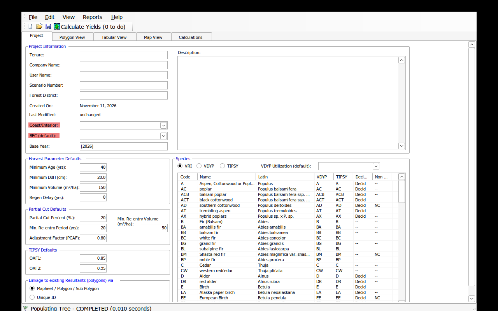

# Woodlot for Windows under Wine

## Status

**Installed and running.** Woodlot for Windows 4.4 runs under Wine 11.0 with
Wine Mono 11.3.0 in a dedicated prefix:

```text
data/wine/woodlot/
```

The screenshot below is the Project tab from the installed application:



## What was installed

| Component | Version / path |
|---|---|
| Wine | 11.0 (`/usr/bin/wine`) |
| Wine Mono | 11.3.0 x86 MSI |
| Wine prefix | `data/wine/woodlot` (win64, WoW64) |
| Woodlot for Windows | 4.4.000 |
| Installer | `data/library/woodlot/raw/aac-tool/woodlot4.4.msi` |
| Application | `data/wine/woodlot/drive_c/Program Files (x86)/Woodlot for Windows 4.4/Woodlot/Woodlot4.exe` |

Woodlot 4.4 is a 32-bit .NET WinForms application. Wine Mono is required;
Microsoft .NET Framework was **not** installed.

## Reproduce the install

```bash
cd /srv/shared-data/gep/ws4/fresh-woodlots
export WINEPREFIX="$PWD/data/wine/woodlot"
export WINEARCH=win64
export WINEDEBUG=-all

wineboot -u
wine msiexec /i \
  "$PWD/data/library/woodlot/raw/aac-tool/woodlot4.4.msi" \
  /qn /norestart /l*v "$WINEPREFIX/install.log"

# Wine Mono (the app is .NET; Wine Mono is not bundled by wineboot here)
curl -L -o /tmp/wine-mono-11.3.0-x86.msi \
  https://dl.winehq.org/wine/wine-mono/11.3.0/wine-mono-11.3.0-x86.msi
wine msiexec /i /tmp/wine-mono-11.3.0-x86.msi /qn
```

## Launch

On a machine with an X display:

```bash
scripts/run_woodlot_wine.sh
```

On the headless container, the launcher starts `Xvfb :99` if needed. For a
visible desktop, use SSH X11 forwarding, a VNC session, or another X server and
set `DISPLAY` before launching.

Headless screenshot check:

```bash
DISPLAY=:99 scripts/run_woodlot_wine.sh &
sleep 10
DISPLAY=:99 scrot /tmp/woodlot.png
```

## Caveats

- The W0026 **Woodlot for Windows project file** and the W0026 **Management
  Plan** are not public. We can run the software and create/test projects, but
  we cannot reproduce the exact 7,311 m³/year calculation without those files.
- Wine Mono is not a complete Microsoft .NET implementation. Basic WinForms
  startup works, but check printing, charts, and uncommon controls before
  relying on them.
- The software is a Windows GUI. Automating it headlessly requires `xdotool`
  and screenshots; interactive use needs an X server/VNC.
- The MSI and training videos are publicly downloadable but are not
  redistributed by this project. See the library licence notes.

## Why this matters for WS4

Woodlot for Windows is useful as a **behavioural reference**:

- non-declining even-flow over 250 years;
- EXCLUDE / AREA netdown / height / age constraints;
- LRSY = culmination MAI × net area;
- Schedule A/B and THLB assumptions.

It is not a replacement for WS4. The likely path is to use W4W to reproduce the
provincial AAC logic, and keep WS4 for richer spatial, scenario, and operational
planning.
